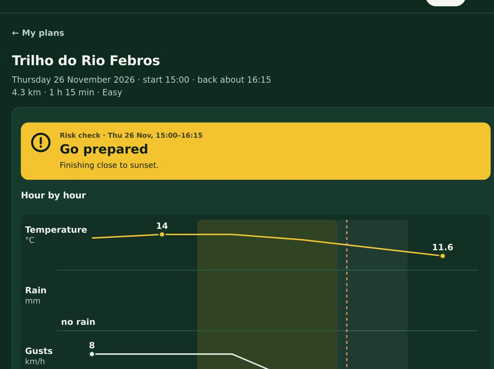

# TrailSense — MVP

Hikers and club organizers in Portugal find a marked trail, plan a hike, and get **a clear verdict for their hike hours**:
forecast, daylight, official IPMA warnings and fire risk, each warning **explained by an explicit rule with a precaution**.
Club organizers run group hikes with sign-ups and a ready-made briefing. Built with an LLM agent following the course
workflow: architecture and spec written first, rules in CLAUDE.md, every change tested before it was accepted.

**Live app:** https://amanesenx.alwaysdata.net · **Public API:** https://amanesenx.alwaysdata.net/api/v1 ·
**Report (PDF):** [docs/TrailSense_A2_MVP_report.pdf](docs/TrailSense_A2_MVP_report.pdf) ·
Demo accounts (fictional people) are shared privately, not published.



## Scope
- **Core MVP (Assignment 1 Priority 0):** sign in with roles (hiker / club organizer) · trail discovery · plan a hike ·
  forecast for the hike hours → rule-based risk check with rule and precaution · group hike with briefing ·
  planning-completeness indicator (K1) · community feed and publish a hike.
- **Extensions** (added after the core worked, each with its own acceptance criteria and tests): likes and comments, profiles,
  IPMA warnings and fire risk, trail condition reports, GPS directions with compass (and a practice mode to try it anywhere), offline use, favourites, read-only public API.
- Details: [SPEC.md](SPEC.md) §2 and §2a.

## Stack
PHP 8.3 (no framework) · PostgreSQL 16 · HTML + one CSS file + small vanilla JS · Leaflet 1.9.4 (CDN with SRI) ·
Open-Meteo (forecast, elevation) · IPMA open data · OpenStreetMap. Layered architecture — see [docs/ARCHITECTURE.md](docs/ARCHITECTURE.md).
Hosted on alwaysdata (auto-deploy from GitHub). No AI is used inside the product.

## Run locally
```bash
cp config/config.example.php config/config.php   # set DB credentials, base_url '/', weather_provider
php bin/db-reset.php                             # schema + demo data (seed.sql)
php -S localhost:8000 -t public                  # open http://localhost:8000
php tests/run.php                                # 171 tests: unit (incl. JavaScript with Node), integration, HTTP — must print FAILED: 0
```
The same suite runs on GitHub Actions on every push ([.github/workflows/tests.yml](.github/workflows/tests.yml)).

## Where to look (assessment criteria)
| Criterion | Evidence |
|---|---|
| Core features end to end | [SPEC.md](SPEC.md) (stories with “so that” + acceptance criteria) · [docs/JOURNEYS.md](docs/JOURNEYS.md) · tests/Http/ |
| Data tables | [database/schema.sql](database/schema.sql) + [database/migrations/](database/migrations/) · [docs/DATA_MODEL.md](docs/DATA_MODEL.md) · [docs/er-diagram.svg](docs/er-diagram.svg) |
| Testing | tests/ (171 automated) · [docs/MANUAL_TESTS.md](docs/MANUAL_TESTS.md) · [docs/TRACEABILITY.md](docs/TRACEABILITY.md) · GitHub Actions |
| LLM good practices | [docs/AI_USE.md](docs/AI_USE.md) (how I used AI and how I checked it), [CLAUDE.md](CLAUDE.md), [AGENTS.md](AGENTS.md), [SPEC.md](SPEC.md), [docs/ARCHITECTURE.md](docs/ARCHITECTURE.md), [docs/DECISIONS.md](docs/DECISIONS.md) (22 ADRs), .claude/ (subagents, command, skill, hooks), [docs/LESSONS.md](docs/LESSONS.md), [docs/DEBT.md](docs/DEBT.md) |
| UX/UI | [docs/UX_REVIEW.md](docs/UX_REVIEW.md) (7 review rounds) · [docs/screenshots/a2/](docs/screenshots/a2/) |
| Online and reachable by other apps | [docs/DEPLOY.md](docs/DEPLOY.md) · [docs/API.md](docs/API.md) + [docs/openapi.yaml](docs/openapi.yaml) |
| Evidence, users, external parties | [docs/VALUE_CASE.md](docs/VALUE_CASE.md) · [docs/research/](docs/research/) (7 interviews) · in the app: footer → “Sources and credits” |
| Live demo | [docs/DEMO_SCRIPT.md](docs/DEMO_SCRIPT.md) |

## Tools in bin/
`db-reset.php` (schema + seed) · `demo-refresh.php` (keeps demo plans upcoming) · `screenshots.py` (report screenshots, run on CI by
`.github/workflows/screenshots.yml`) · `gen-trail-data.py` (builds trail data from OpenStreetMap) · `hooks/` (agent hooks).
